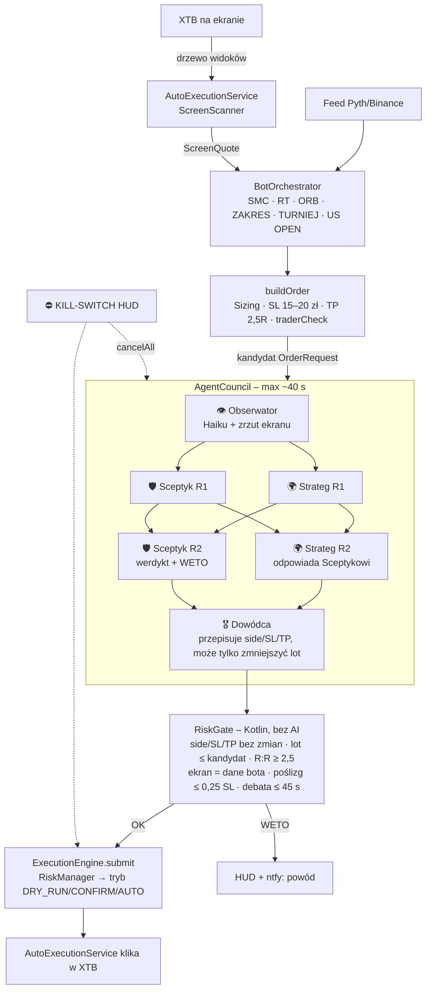

# Rada AI (4 agenty) – nakładka na Algo HUD

## Gdzie siedzi w bocie

Rada **nie zastępuje** strategii ani RiskManagera. Wchodzi jako bramka między gotowym kandydatem na wejście
a `engine.submit()`. Wyjścia, schodki SL, zamknięcia na przeciwny trend i kill-switch idą jak dotąd – bez AI.

## Tryby rady
- `OFF` – wyłączona.
- `ADVISORY` (domyślnie) – debatuje i loguje werdykt, ale bot wchodzi jak dotąd. Do porównania: czy weta rady
  trafiają w przegrane transakcje.
- `GATE` – weto blokuje wejście, ADJUST zmniejsza lot (min. 0.006). Błąd/timeout API = weto (fail-closed).

## Dlaczego zrzut przez AccessibilityService, a nie MediaProjection
`takeScreenshot()` (Android 11+) działa w już włączonej usłudze ułatwień dostępu – bez okna zgody przy każdym
starcie (Android 14+ wymaga nowej zgody MediaProjection za każdym razem) i bez nowej usługi pierwszoplanowej.
Manifest bez zmian; jedyna zmiana: `android:canTakeScreenshot="true"` w `accessibility_config.xml`
(po aktualizacji APK może być trzeba wyłączyć i włączyć usługę Algo HUD w Ułatwieniach dostępu).
Jeśli XTB blokuje zrzuty (FLAG_SECURE), Obserwator dostaje tekst drzewa widoków (`dumpTargetWindow()`).

## Krok 2: podpięcie, świadomość, samonaprawa widoku

- **Podpięcie:** wszystkie nowe wejścia (`handleSignal`, `smcTick`, `enterAggressive` → RT/ORB/ZAKRES/AI-świece/US OPEN)
  idą przez `BotOrchestrator.submitEntry()`. W GATE debata leci w tle – pętla cen, wyjścia i schodki SL nie czekają.
  Po werdykcie: ponowna kontrola (kill-switch? już w pozycji?) i dopiero `engine.submit`. Weto = 3 min przerwy dla kierunku.
- **Świadomość (omni-awareness):** `BotOrchestrator.awareness()` – tryb, kill-switch, wynik dnia, feed, usługa ułatwień
  dostępu, aplikacja na wierzchu, ekran błędu XTB, status samonaprawy, ostatni odczyt XTB i środki, pozycje w księdze bota,
  wiersze pozycji widoczne w XTB, bramka danych, przerwa po stracie, ntfy, ostatni alarm, 6 ostatnich zdarzeń bota.
  Trafia do wszystkich agentów. Pozycja w XTB spoza księgi bota = weto RiskGate (jedna pozycja naraz).
- **Samonaprawa widoku we wszystkich trybach** (`navAutonomy`, domyślnie włączona; zlecenia dalej tylko w AUTO):
  XTB wraca na wierzch po 20 s (nie z Ustawień, instalatora, Algo HUD, okien systemowych; AnyDesk – po 2 min),
  bot wraca na bilet GOLD, zamyka wiszące okna, naciska „Odśwież” na ekranie błędu.
  Pauza: przycisk ⏸ w HUD (10 min) albo w aplikacji (30 min).
- **Nawigator AI** (zapas): gdy zwykłe szukanie GOLD zawiedzie – zrzut → Haiku wskazuje gdzie dotknąć → bot sprawdza bilet.
  Maks. 5 kroków / 45 s, maks. 6 uruchomień na godzinę. Odmawia dotyku poza XTB i na przyciskach Sell/Buy/Potwierdź/Zamknij…
- **Kill-switch:** przerywa debatę i nawigację AI (także zapytanie HTTP w locie), zwalnia blokadę UI dla zamykania pozycji.

## Klucz API
Klucz Anthropic wpisuje się w aplikacji (prefs `council_api_key`). Nie wolno go wkładać do kodu ani do sekretów
GitHub Actions – APK z artefaktów publicznego repo może pobrać każdy.

## Dokładniejsza obserwacja świec

`CandleWatch` liczy geometrię OHLC i relacje świec z istniejącego feedu bota. M1 i M5
są aktualizowane tym samym tickiem przed oceną strategii. Lokalny HUD w Szczegółach
odświeża podsumowanie co sekundę; częstotliwość źródła cen pozostaje bez zmian.
Rada otrzymuje snapshot przy kandydacie na wejście, a nie wywołanie API co sekundę.

Raport zawiera 30 zamkniętych M1 i 24 M5 z czasem UTC, korpusy, knoty, położenie
zamknięcia w zakresie, geometrię ostatnich sześciu świec, objęcia, inside/outside bar,
zamknięcia poza H/L poprzedniej świecy i powroty do jej zakresu. Świeca w budowie ma
osobną sekcję: upływ czasu, czas do końca i wstępne relacje. Nie jest potwierdzonym sygnałem.

Oznaczane są luki, błędny OHLC, nieaktualna świeca oraz wiek ceny powyżej 10 sekund
(próg informacyjny, nie dodatkowa bramka wykonania). Brakujące świece nie są uzupełniane.
Nie ma danych o wolumenie. OHLC feedu nie musi pokrywać się z OHLC XTB; przesunięcie
cen nie gwarantuje zgodności knotów. Analiza nie zmienia parametrów ryzyka ani sama
nie otwiera/zamyka pozycji. W GATE stanowi dodatkowe dane do oceny rady.

## Gemini i Groq — tryb oszczędny

W aplikacji wybierz Gemini, Groq, Gemini + Groq albo dotychczasowe Claude. Dla trybu
mieszanego wymagane są oba klucze: Gemini ocenia ekran i podsumowuje decyzję, Groq
realizuje Stratega i Sceptyka. Nawigator używa dostawcy Obserwatora. Klucze są osobne,
nie trafiają do repo/artefaktów; dane i zrzuty trafiają tylko do wybranych dostawców.
Dotychczasowy klucz Claude zachowuje wybór Claude do ręcznej zmiany.

Debata: Obserwator → Strateg → Sceptyk → Dowódca, do 4 zapytań zamiast 6.
Bez drugiej rundy, najwyżej raz na 10 minut, 12 debat/dobę UTC. Liczniki są zapisane
przed żądaniem i przetrwają restart. Rada i nawigator współdzielą limit 60 żądań na
dostawcę/dobę. HTTP 429 włącza przerwę minimum 15 minut (dłuższą dla Retry-After w sekundach).
Nie ma automatycznych ponowień ani przełączania dostawcy przy błędzie. GATE blokuje
wejście przy limitach, błędzie API, braku klucza lub niepełnym JSON. ADVISORY pomija
opinię bez zatrzymywania dotychczasowej logiki bota; OFF nie odpytuje rady.

Limity aplikacji nie gwarantują darmowości: rozliczenia, tokeny i dostępność modeli
zależą od planu dostawcy. Domyślnie gemini-3.8-flash oraz qwen/qwen3.8-27b; nazwy
można zmienić w aplikacji, wybierając model obsługujący JSON i obrazy.
Dokumentacja sprawdzona 13.11.2026:
- https://ai.google.dev/api/generate-content
- https://ai.google.dev/gemini-api/docs/pricing
- https://console.groq.com/docs/vision
- https://console.groq.com/docs/structured-outputs

Testy bez kluczy sprawdzają żądania, odpowiedzi, odrzucanie uciętych odpowiedzi,
429 bez wycieku treści błędu, budżety po restarcie i blokadę GATE. Połączenie z
prawdziwym kontem wymaga sprawdzenia na telefonie po wpisaniu własnych kluczy.

## Diagnostyka braku bieżących cen

Binance: połączenia WebSocket rotują między publicznym hostem danych na 443,
standardowym hostem na 443 oraz 9443. Jeśli dla symbolu od 10 s nie ma nowej
transakcji, co 5 s działa zapas HTTPS `/api/v3/trades?limit=100` na
`data-api.binance.vision`. REST zachowuje czas i ID transakcji giełdy; powtórne
odczyty nie odmładzają ceny. Stare (>20 s), przyszłe (>2 s), błędne i powtórzone
transakcje są odrzucane. 429/418 włącza przerwę co najmniej 60 s z Retry-After.
Nie podmieniamy feedu kursem z ekranu XTB. Przy braku danych wejścia nadal blokowane.

HUD pokazuje diagnostykę wybranego źródła (Pyth albo Binance). Usługa dostępności
ustawia flagi odczytu interaktywnych okien przy połączeniu i reaguje na WINDOWS_CHANGED;
XTB rozpoznawane także po jednoznacznym pakiecie. Weryfikacja na telefonie nadal wymagana.
